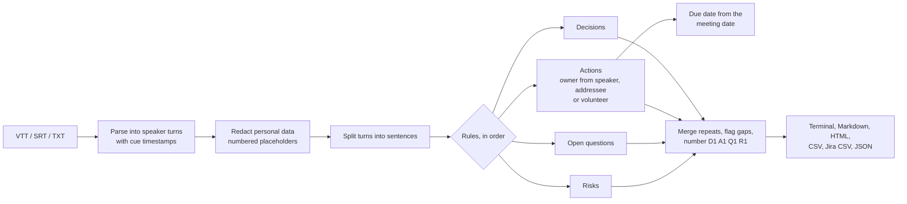

# meeting-to-actions

Turn a meeting transcript into decisions, actions with owners and due dates, open questions and risks. It runs offline, removes personal data first, and quotes the line behind every item.


▶ [Watch the 55-second demo video](https://github.com/sumankrsh/meeting-to-actions/releases/latest/download/demo.mp4)

## The problem

Most meetings now produce a transcript (Teams and Zoom write WebVTT, other tools write SRT or plain text), but someone still has to read it and write the minutes. Notes tools that do this for you send the whole transcript, names, phone numbers and customer details included, to a hosted model, and give you back a tidy summary you can't easily check. Two things go wrong:

- **Actions without owners.** "We need to fix the intake form" gets written down, and nobody notices that nobody said "I'll do it". A request someone turned down ("Sorry, I can't this week") still appears as their action.
- **No trail.** When an action is disputed a month later, a summary can't tell you who said what, or when.

`meeting-to-actions` is a small rule-based tool for teams who need to show their working. Each item records the sentence it came from, the speaker and the timestamp. It works out owners from who was asked and who agreed, resolves "by Friday" to a date, and flags any action that has no owner or no due date. Redaction runs before any extraction, so no quote in a report (and nothing sent to an optional LLM) contains the redacted values.

## Quickstart

```bash
git clone https://github.com/sumankrsh/meeting-to-actions && cd meeting-to-actions
pip install .
meeting-to-actions extract examples/claims-steering.vtt --html minutes.html --jira jira-import.csv
```

The bundled transcript is a synthetic 3½-minute steering-group meeting for a made-up insurer, in Teams-style WebVTT. On a Linux cloud machine the command took about a quarter of a second, with no API key and no network. The terminal shows:

| | Found |
|---|---:|
| Personal data redacted first | 1 card number, 1 email, 1 phone number, 1 customer name |
| Decisions | 2 |
| Actions, each with an owner | 8 (4 with a due date) |
| Open questions | 2 |
| Risks | 3 |

`minutes.html` is a single page with each item and its quote. `jira-import.csv` has one row per action for Jira's CSV import.

Three things in that meeting show how ownership is decided:

- Priya asks Daniel to draft a risk note and he says "I can't this week", so the request is dropped. Later, "Tom will draft the risk note" gives it to Tom.
- Daniel says "We need to stop personal data going into free text", and Tom answers "I'll take that". The action goes to Tom, and the report records his reply.
- Grace says she'll send survey results "by end of week", then "Actually, scratch that ... I'll send the results next Tuesday instead". Only the second version is kept, due 2026-12-01.

To see exactly what the extractor saw after redaction:

```bash
meeting-to-actions redact examples/claims-steering.vtt
```

## Features

- **Reads common transcript formats.** WebVTT with `<v Speaker>` voice tags (Teams) or `Speaker: text` cues (Zoom), SRT, and plain text with or without `[hh:mm:ss]` timestamps. Consecutive cues from one speaker are joined into one turn, and each cue keeps its own timestamp. A `Title:` and `Date:` in a VTT `NOTE` block or a text header are picked up, as is an `Attendees:` line.
- **Redaction before extraction.** Email addresses, phone numbers, payment card numbers (Luhn-checked), IBANs (checksum-checked), US social security numbers, UK National Insurance numbers, IPv4 addresses, and names after a title (Mr, Mrs, Ms, Dr ...). Each value becomes a numbered placeholder such as `[PHONE-1]`, the same placeholder every time it recurs. Speaker names are kept, because they are the owners.
- **Owners from the conversation.** "I'll ..." belongs to the speaker; "Grace, can you ...?" belongs to Grace once she answers "Sure"; a refusal drops it; "we need to ..." stays unassigned until someone says "I'll take that" or "Leave it with me"; "Tom will ..." and "Action: Tom to ..." name the owner directly. `meeting-to-actions rules` lists all ten rules.
- **Due dates you can check.** "by Friday", "next Tuesday", "tomorrow", "end of week", "end of month", "in 2 weeks", "the 5th of December", ISO dates. Relative dates are resolved against the meeting date (see [How it works](#how-it-works)); without one, the phrase is kept as said and flagged.
- **Review flags.** Actions are marked `no owner`, `no due date`, `due date not resolved` or `owner not in meeting`, with a confidence of high, medium or low. Repeats ("To recap, Tom will draft the risk note") are merged and the extra timestamps listed.
- **Exports.** Terminal tables, Markdown minutes, a single-file HTML page (no scripts, no external requests, light and dark themes), CSV of every item, a Jira CSV import file of the actions, and JSON.
- **A gate for workflows.** `--require-owner` exits 1 when any action has no owner, so a minutes workflow can stop before anything is posted.
- **Measure it on your own meetings.** `meeting-to-actions eval TRANSCRIPT LABELS.json` scores the extractor against items you labelled by hand: precision and recall per type, plus how many owners and due dates were right.
- **Optional LLM extractor.** `--extractor llm` sends the redacted transcript to any OpenAI-compatible chat endpoint, such as a local Ollama. Every item the model returns must point at a real turn and quote it word for word, or it is dropped, and owners must be people in the meeting.

## How it works



1. Each turn is split into sentences. The rules run in a fixed order: retraction, reply to a pending request, decision, `Action:` marker, request, named owner, self-commitment, unowned need, open question, risk. A sentence produces at most one item.
2. The extractor keeps a little state as it reads. A request waits up to two turns for its addressee to accept or refuse, and an unowned "we need to ..." waits two turns for a volunteer. "Scratch that" withdraws the speaker's latest action or decision from the last two turns.
3. Talk about the meeting itself ("I'll be honest", "let me share my screen", "I'll hand over to Bo") is not counted as a commitment.
4. Due dates are resolved against the meeting date: a bare weekday is the first such day after the meeting; "next Tuesday" is the Tuesday of the following Monday-to-Sunday week; "end of week" is that week's Friday; "next week" is the following Monday; "end of month" is the last day of the month; a day and month with no year is the next such date.
5. Items of the same type and owner whose content words mostly overlap are merged. An owned action that restates an unowned one from the previous two turns replaces it.

### How well it works

Measured with `meeting-to-actions eval` on four synthetic transcripts, labelled by hand by the person who wrote them:

| Transcript | Labelled items | Found | Matched | Owner right | Due date right |
|---|---:|---:|---:|---:|---:|
| `claims-steering.vtt` | 15 | 15 | 15 | 8/8 | 8/8 |
| `vendor-review.txt` | 8 | 8 | 8 | 4/4 | 4/4 |
| `data-platform-standup.srt` (with `--date 2026-11-25`) | 8 | 8 | 8 | 4/4 | 4/4 |
| `holdout/store-ops-review.vtt` | 10 | 8 | 8 | 4/4 | 3/4 |

The first three are the development set: the rules were written and adjusted against them, so their perfect scores show the rules work as designed, not how well they generalise. The held-out transcript was written and labelled after the rules were finished and was not used to tune them. On it, the extractor missed a question that the meeting answered with a decision ("Should we pause the trial over Christmas?"), and a risk phrased as "That might delay the January rollout", which a rule for short sentences that point back ("That's my worry too") filtered out. It also didn't resolve "this week" to a date. A matched item has the same type and shares at least two content words, making up 40% of the shorter text, with the label. Four small synthetic meetings are not a benchmark: run `eval` on a few of your own labelled meetings before you rely on it.

## Configuration

### `extract` options

| Option | Default | Meaning |
|---|---|---|
| `--html`, `--markdown`, `--csv`, `--jira`, `--json` | off | Write that report to this path. |
| `--date YYYY-MM-DD` | from the transcript | Meeting date for resolving "Friday", "next week" and so on. |
| `--attendee NAME` | | Someone who can own actions without having spoken. Repeat for more. |
| `--format vtt\|srt\|txt` | from the file extension | Force the input format. |
| `--no-redact` | off | Keep personal data in quotes. The reports say redaction was off. |
| `--extractor rules\|llm` | `rules` | See below. |
| `--require-owner` | off | Exit 1 when any action has no owner. |
| `-q`, `--quiet` | off | Print only the files written. |

Exit status: 0 on success, 1 when `--require-owner` fails, 2 for a bad file or option.

### Jira import

`--jira` writes the columns `Summary`, `Issue Type` (Task), `Assignee`, `Due Date`, `Labels` (`meeting-action`) and `Description`, where the description holds the meeting title, the quote, who said it and when, and any review flags. In Jira's CSV import, map the columns to fields, set the date format to `yyyy-MM-dd`, and map `Assignee` to Jira users (or leave it unmapped), since the file has the names as spoken.

### Labels for `eval`

```json
{"items": [
  {"type": "action", "text": "Send the scoring sheet to procurement", "owner": "Ravi Nair", "due": "2026-11-23"},
  {"type": "decision", "text": "Go with Vendor A for the pilot"}
]}
```

`type` is `decision`, `action`, `question` or `risk`. `owner` and `due` are optional and only scored for actions. See [examples/labels/](examples/labels/).

### Optional LLM extractor

```bash
export M2A_LLM_BASE_URL=http://localhost:11434/v1   # any OpenAI-compatible /chat/completions endpoint
export M2A_LLM_MODEL=your-model-name
export M2A_LLM_API_KEY=...                          # only if the endpoint needs one
meeting-to-actions extract examples/vendor-review.txt --extractor llm
```

Only the redacted transcript is sent. Items whose quote isn't found in the turn they cite, or whose type is unknown, are dropped, and owners who aren't in the meeting are cleared. The output reports how many items were dropped and why. The LLM path is tested against a local fake of the chat-completions API; its quality depends on the model you choose and has not been measured here.

## Limitations

- The rules are written for English meetings with a clear "I'll", "can you", "we've agreed". Indirect commitments ("that sounds like one for my team") and decisions reached without a decision phrase are missed. Expect to edit the output, not to paste it unread.
- Owners come from speaker labels. A transcript without speaker names ("Speaker 1") gives owners like "Speaker 1", and a first name shared by two people goes to whoever is listed first.
- Item text is the speaker's own clause, lightly trimmed. Pronouns stay as said ("Raise it with the model risk committee"), so check the quote for what "it" means.
- Redaction is pattern-based. It doesn't find names without a title, addresses, dates of birth or health details mentioned in passing. Use `meeting-to-actions redact` to check a transcript before you share the output.
- "this week", "soon" and numeric dates like 12/12 aren't resolved, because they are ambiguous. Linear and other trackers have no dedicated export; use the CSV or JSON.
- All examples are synthetic: the companies, people, phone numbers, card and bank numbers are made up or published test values.

## More tools

Part of a small family of open-source tools for running AI with governance built in:

- **[ai-register](https://github.com/sumankrsh/ai-register)**: scans a codebase and keeps an AI inventory for EU AI Act and ISO/IEC 42001 reviews.
- **[mcp-gatekeeper](https://github.com/sumankrsh/mcp-gatekeeper)**: permissions, approvals and a tamper-evident audit log for MCP tool calls.
- **[enterprise-data-skills](https://github.com/sumankrsh/enterprise-data-skills)**: everyday data checks (SQL review, profiling, PII scans, model cards) for people and agents.
- **[agentbreak](https://github.com/sumankrsh/agentbreak)**: tests whether an attack makes an AI agent take an unauthorised action.
- **[prompt-ci](https://github.com/sumankrsh/prompt-ci)**: keeps prompts as owned, versioned and tested code, with a CI gate on changes.
- **[ai-policy-lint](https://github.com/sumankrsh/ai-policy-lint)**: checks agent configs, MCP configs and prompts against your company's AI policy.
- **[agent-crashlab](https://github.com/sumankrsh/agent-crashlab)**: injects tool failures into an agent and counts what it does twice.
- **[model-cost-pilot](https://github.com/sumankrsh/model-cost-pilot)**: routes each kind of request to the cheapest model that still passes your checks.
- **[contextlens](https://github.com/sumankrsh/contextlens)**: shows what each LLM call's context window held and where tokens were wasted.
- **meeting-to-actions**: this tool, turning transcripts into owned, dated actions with the quote behind each one.

See [github.com/sumankrsh](https://github.com/sumankrsh) for newer tools.

## Credits

No code was adapted from other projects. The [WebVTT](https://www.w3.org/TR/webvtt1/) specification defines the voice tags read here. Hosted notes tools and LLM-based projects such as [LLM-Minutes-of-Meeting](https://github.com/inboxpraveen/LLM-Minutes-of-Meeting) also transcribe audio and write summaries; this tool starts from an existing transcript and focuses on owners, dates and an evidence trail.

## Licence

MIT. See [LICENSE](LICENSE).
